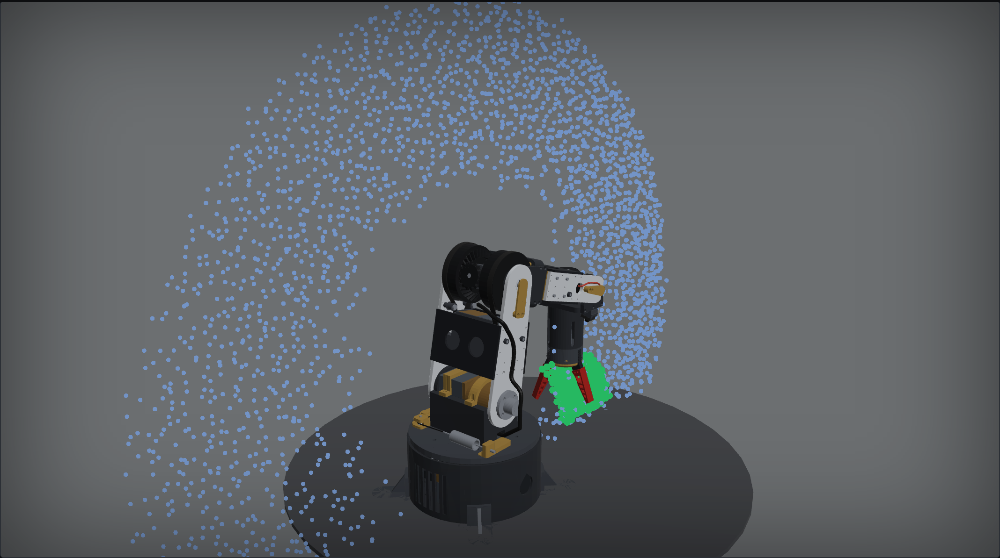

# IDRA: Infinite Differential Roll Arm

A 6-axis desk robot arm with a **wrist that spins endlessly**: the roll joint has no end stop and never has to unwind. Two bevel differentials move elbow and wrist. *Idra* is Italian for hydra.

[](https://enricomichelato.github.io/Idra/)

**[▶ Drive IDRA in your browser](https://enricomichelato.github.io/Idra/)**: press an arrow key and you are in control. Works on any computer; on a phone there is an on-screen pad. Nothing to install.

IDRA is a design model: nothing has been built yet.

## Keyboard control

The simulator has a keyboard deck under the 3D view: the keys light up as you press them, and you can click them too. You move the grip and the arm works out all six joints by itself. The first movement key takes control.

| Keys | What they do |
|---|---|
| ← → | orbit around the base (cylindrical mode) |
| ↑ ↓ | reach out and pull in |
| W / S | up and down |
| A / D | tilt the hand |
| Q / E | spin the hand, endlessly |
| Z / X | close and open the fingers |
| M | switch mode: cylindrical, view, hand, joints |
| O | hand follows the arm, or stays fixed in space |
| P | ready pose |
| Shift | fast |
| R / F | forearm pronation (joints mode) |
| C / Esc | take / release control |

When a move is impossible, the panel in the top left says why: out of reach, a joint limit, or fingers on the desk. **Reachable space** draws the cloud of points the grip can reach.

More: **[kinematics, step by step](https://enricomichelato.github.io/Idra/kinematics.html)**.

## What makes it different

- **Endless roll.** The hand turns without limit: the roll joint has no end stop, and the firmware never has to unwind it.
- **Three-finger hand.** Fin Ray fingers driven by one worm; the grip holds with the power off, and the end stop and the force limit are done in hardware.
- **Two bevel differentials.**
  - **Elbow:** flexion and pronation from two motors, module 3 spiral bevels and an idler satellite.
  - **Wrist:** pitch and roll, with its motors placed near the elbow so there is less weight at the tip.
- **Bones on the outside.** The aluminium plates are the outermost parts at every joint, like an insect's shell; the elbow cradle and the wrist flange turn between them.
- **Joint encoders.** Four AS5600 sensors read elbow flexion and pronation, wrist pitch and roll directly.
- **Built from scripts.** Four laser-cut aluminium plates and about 60 printed parts that fit a 256 × 256 mm bed. Every part comes from CadQuery scripts, and a fit test coupon tunes bearing seats and holes to your printer.

## Numbers

| | |
|---|---|
| Axes | 6: base, shoulder, elbow, pronation, wrist pitch, endless wrist roll |
| Lengths | upper arm 205 mm, forearm 240 mm; grip centre 205 mm from the wrist centre |
| Reach | about 650 mm to the grip; shoulder axis 183 mm above the desk |
| Target payload | 500 g (spring gravity balancer on the shoulder) |
| Structure | laser-cut 6 mm aluminium bones (`mechanical/cad/LASER_CUT.md`), printed PETG / PETG-CF for the rest |
| Motors | NEMA23 with a 20:1 steel planetary at the shoulder, 5 × NEMA17 (base 33.3:1 and elbow 40:1 with 5:1 planetaries, wrist 5.57:1), 25 mm metal gear motor in the hand |
| Grip | about 16 N per finger, holds 1 kg by friction (estimate) |
| Electronics | ESP32-S3 + 6 × TMC2209 in the base; XIAO ESP32S3 Sense with camera on the wrist flange |
| Reference printer | Elegoo Centauri Carbon |

## Status

| Part | Status |
|---|---|
| CAD: arm v0.32, wrist v1.29, hand v2.6 | 58 printed parts with oriented STLs, 4 laser-cut aluminium bones with DXFs, every joint has its fasteners; nothing built yet |
| Forward and inverse kinematics, joints → motors | done and verified (`control/`) |
| Hand electronics | schematic with starting values, bench test pending |
| Firmware | not started |
| Printing and assembly | `mechanical/cad/PRINT_LIST.md`, `mechanical/cad/ASSEMBLY.md` |
| Still to model | cable connectors, small-part fixings (see `mechanical/cad/BOM.md`) |

## Layout

```
docs/                    GitHub Pages site (built by tools/build_site.py)
mechanical/cad/
  arm_v0/                base, shoulder, upper arm, elbow, forearm + 3D viewer (viewer_build.py)
  wrist_v0/              wrist differential and hand (hand_v2.py, export_print.py)
  common/                fit.py (print clearances) and the fit test coupon
  BOM.md                 hardware list
  LASER_CUT.md           the four aluminium bones: DXF files and finishing
  PRINT_LIST.md          every printed part: file, quantity, material, supports
  ASSEMBLY.md            assembly order, fasteners per joint, bench tests
  WRIST_BUILD.md         building the wrist and hand alone on the bench: what to print and buy (tools/wrist_kit.py)
control/                 kinematics.py (forward, inverse, motor mixing), dynamics.py (torques, motor sizing), hand_grip.py, stiffness.py (each writes a *_report.md)
electronics/             hand electronics: schematics (schemdraw) and page
tools/                   site build, print audit, oriented STL export, DXF export, mass model from the CAD
  checks/                interference checks (arm, wrist, hand) and kinematics self-test
STATUS.md                where the project stands, how to regenerate and check everything, open items
```

Design notes: [base and electronics](mechanical/cad/arm_v0/base_notes.md) · [hand: printing and assembly](mechanical/cad/wrist_v0/hand_print_notes.md) · [fit test](mechanical/cad/common/fit_test.md) · [kinematics](control/kinematics.md) · [BOM](mechanical/cad/BOM.md)

## Rebuilding models and pages

```bash
pip install -r requirements.txt
cd mechanical/cad/arm_v0 && python3 viewer_build.py         # whole arm + 3D viewer (about 10 minutes)
python3 viewer_build.py --tpl                               # page only, reusing the cached meshes
cd ../wrist_v0 && python3 export_print.py                   # hand STLs, already oriented for printing
cd ../common && python3 fit_test.py                         # fit test coupon
cd ../../../electronics && python3 hand_passive_schematic.py && python3 build_page.py
cd .. && python3 tools/build_site.py --preview              # refresh docs/ (the preview needs Playwright)
```

STLs and other generated files are not in the repository: they go to the `out/` folders. The full list of commands and the checks to run after a change are in [STATUS.md](STATUS.md).

## Licence

Copyright © 2026 Enrico Michelato. **All rights reserved.** You may read the files and run the simulator, but no licence is granted to copy, modify, build, distribute or use this design, in whole or in part, without written permission. See [LICENSE](LICENSE).
